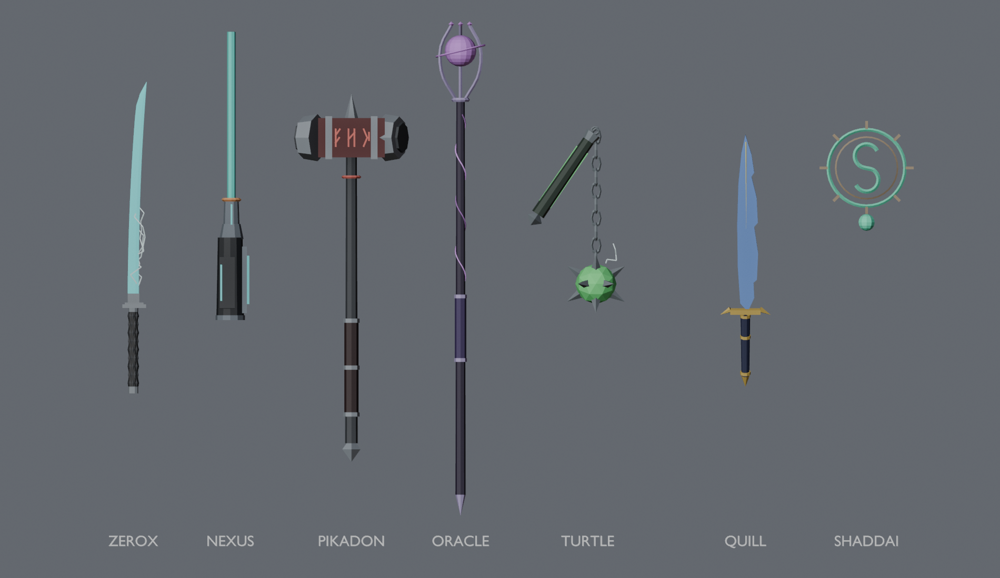

# Agent weapons (code-built) — `public/world-weapons.js`

The 7 agent weapons are built with three.js primitives only: no textures, no downloads and no fal spend. All sizes are in metres. Each weapon is under 3k tris (zerox 816, nexus 632, pikadon 662, oracle 1640, turtle 1104, quill 432, shaddai 1152). `update()` allocates nothing per frame.

Spec: [GAME-SYSTEMS-PLAN.md](GAME-SYSTEMS-PLAN.md) §1–2. Preview: 

| Agent | Weapon | Live parts |
|---|---|---|
| ZEROX | Teal lightning katana: diamond-wrapped grip, square tsuba, curved single-edge glowing blade | `w.arcs` (7 pooled jittered line strips) |
| NEXUS | Wrist beam cannon, teal and orange | `w.beam` (Group, +Y, shown on `attack`; `w.beamLength` = metres) |
| PIKADON | Rune warhammer, dark red and steel, glowing runes | rune pulse |
| ORACLE | Purple wand-staff with a floating orb and ring | `w.orb` bob/spin |
| TURTLE | Electric spiked flail, instanced chain links, green ball | `w.chain` (world-space verlet, bounded) + arcs |
| QUILL | Feather-shaped quill-blade | `w.trail` ink ribbon (20 samples, shown on attack/charge) |
| SHADDAI | Emerald S-sigil ring and palm glow (nothing held in the hand) | `w.sigil` spin/scale |

## API

```js
const w = window.buildAgentWeapon({ THREE, agent: 'zerox', palette: { glow: 0x19f0ff } }); // palette optional
w.group         // THREE.Group. Weapon space: +Y = tip, -Z = edge/strike side, +Z = back of the hand
w.grip          // Object3D at the fist point inside the handle
w.sheathe       // { mode: 'back' | 'hand' | 'hide', pos:[right,up,fwd] m from chest bone, dir, face }
w.emissiveMats  // hand these to the day/night ramp
w.update(dt, state)   // 'idle' | 'drawn' | 'attack' | 'charge'

window.attachWeapon(w, skeletonRoot, { hand: 'right', forward?, unitsPerMetre?, socket?, sheathed? })
window.drawWeapon(w); window.sheatheWeapon(w);
window.findHandBone(root, 'right' | 'left', socketName?)
```

- **Glow vs. ramp:** the day/night ramp owns `emissiveIntensity`. `update()` only scales the emissive colour and the opacity of the additive shells, so the two never overwrite each other.
- **Bone lookup:** names are compared after lower-casing, stripping `mixamorig[N]:`/`_` and removing non-alphanumerics. The following all resolve:
  - Meshy v6 / Mixamo `RightHand` (the real `_m6` rigs, see below)
  - `mixamorig:RightHand`
  - UAL2 / UE `hand_r`
  - Blender `hand.R`
  - Biped `Bip01 R Hand`

  After those, it tries a named socket: `opts.socket`, then `socket_hand_r`, `weapon_r`, … Finally it tries a loose match on "hand" plus a side marker, excluding finger names.
- **Orientation:** the orientation is solved once, at attach time, from the rest pose, so it does not depend on each rig's bone axes (NEXUS and PIKADON hips are axis-rotated compared with QUILL and ZEROX).
  - Blade weapons point toward body-forward, taken from the feet (toe minus foot) or `opts.forward`, with the back of the hand facing up.
  - NEXUS (`frame: 'arm'`) points along forearm→hand.
  - The grip sits 8.5 cm past the wrist.
  - Scale = `unitsPerMetre`, which defaults to the root's world scale. This means a cm-armature (Armature scale 0.01) still gets metre weapons.
  - Call attach **right after load, before the mixer runs**, the same way as `attachUAL`.
- **Sheathe:** blade weapons go to a back socket on the deepest spine/chest bone (Meshy `Spine`, UAL2 `spine_03`). NEXUS stays on the arm, powered down. SHADDAI hides.

Real Meshy v6 bone names (`_m6/zerox`, `_m6/nexus`):
`Hips Spine02 Spine01 Spine neck Head headfront head_end`
`LeftShoulder LeftArm LeftForeArm LeftHand` and the matching `Right…` bones
`LeftUpLeg LeftLeg LeftFoot LeftToeBase` and the matching `Right…` bones.
There are no finger bones and the Armature has a 0.01 scale.

## Host snippet (for later; the host is not wired yet)

```html
<script src="world-weapons.js"></script>
```
```js
// after the agent body GLB loads (rest pose), before mixer.update / attachUAL:
const weapon = window.buildAgentWeapon({ THREE, agent: agentId });
window.attachWeapon(weapon, gltf.scene, { hand: 'right', sheathed: true });
if (_v4Sky && _v4Sky.addEmissive) weapon.emissiveMats.forEach(m => _v4Sky.addEmissive(m));
// input / animation events
onDraw    = () => window.drawWeapon(weapon);      // on the draw-weapon clip's grab frame
onSheathe = () => window.sheatheWeapon(weapon);   // on the sheathe clip's release frame
// per frame
weapon.update(dt, attacking ? 'attack' : charging ? 'charge' : weapon.drawn ? 'drawn' : 'idle');
```

Tests: `node tools/tests/world-weapons.test.cjs < /dev/null` (real three r160, plus the two real `_m6` rigs parsed from the GLB JSON chunk).
